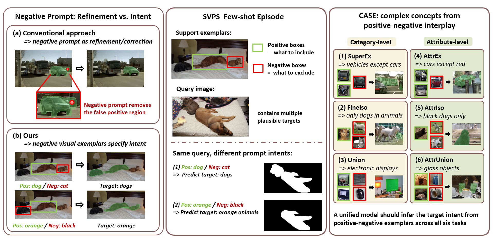
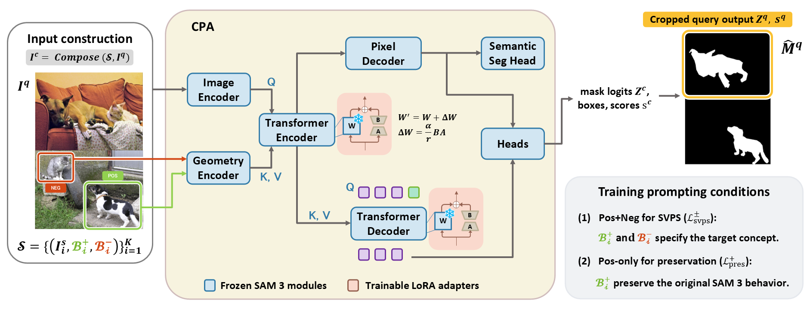

# CASE: Concept-Aware Segmentation from Positive and Negative Visual Exemplars

### ACCV 2026

[Paper (coming soon)](#) | [CASE_DATA](https://github.com/WongKinYiu/FSS-CASE/releases/tag/v1.0)

<p align="center">
  
</p>

## Overview

Few-shot semantic segmentation typically specifies a target using only positive
support examples. However, positive examples alone can be ambiguous when the
desired concept depends on exclusion, fine-grained discrimination, functional
grouping, or visual attributes.

For example, positive exemplars of **red cars** may be interpreted simply as
*car*, while examples of **buses and trains** may lead a model to segment all
vehicles, including cars that should be excluded.

We formulate this problem as **Specified Visual Prompt Segmentation (SVPS)**,
where the target concept is jointly specified by **positive and negative visual
exemplars**. Positive exemplars provide evidence for what should be included,
while negative exemplars define related categories, attributes, or instances
that should be excluded.

To study this setting, we introduce:

- **SVPS**, a segmentation setting in which positive and negative visual
  exemplars jointly specify the target concept.
- **CASE**, a benchmark built on COCO and PACO containing six category- and
  attribute-level task families.
- **Concept Prompt Adaptation (CPA)**, a lightweight adaptation of SAM 3 that
  improves positive-negative prompt interpretation while preserving
  positive-only few-shot segmentation ability.

  ## CASE Benchmark

CASE evaluates whether a model can infer a target concept from the relationship
between positive and negative visual exemplars.

### Category-level concepts

- **SuperEx — Supercategory Exclusion:** segment a broad category while
  excluding one specified subclass.
- **FineIso — Fine-grained Isolation:** isolate one fine-grained category from
  related categories in the same supercategory.
- **Union — Functional Union:** group different categories that share a
  higher-level functional concept.

### Attribute-level concepts

- **AttrEx — Attribute Exclusion:** segment a category while excluding objects
  with a specified attribute.
- **AttrIso — Attribute Isolation:** isolate objects with a specified attribute
  within a category.
- **AttrUnion — Attribute Union:** group objects across categories that share
  the same visual attribute.

  CASE contains **461,390 candidate training episodes** and **23,216 fixed
evaluation episodes** across **406 structured concepts**.

- Category-level tasks are constructed from COCO.
- Attribute-level tasks are constructed from PACO.
- Both 1-shot and 5-shot protocols are provided.

## Concept Prompt Adaptation

<p align="center">
  
</p>

CPA adapts SAM 3 to SVPS while keeping the pretrained SAM 3 model frozen.
Support and query images are composed into a shared canvas, and positive and
negative support boxes are used as visual prompts.

During training, CPA learns to interpret positive-negative exemplars for CASE
while using a positive-only preservation objective to retain the original
few-shot segmentation behavior of SAM 3.

## Main Results

### Results on CASE

We compare CPA with representative few-shot segmentation methods on CASE.
Methods that do not natively support negative visual exemplars are evaluated
using positive-only prompts. FSS-SAM3 and CPA are additionally evaluated with
positive-negative prompts.

| Method | Prompt | 1-shot Cat. | 1-shot Attr. | 1-shot Mean | 5-shot Cat. | 5-shot Attr. | 5-shot Mean |
| --- | --- | ---: | ---: | ---: | ---: | ---: | ---: |
| GF-SAM | Pos Only | 31.24 | 14.81 | 23.03 | 43.47 | 21.18 | 32.32 |
| FSSAM | Pos Only | 34.47 | 15.99 | 25.23 | 45.58 | 18.75 | 32.17 |
| SANSA | Pos Only | 36.81 | 18.40 | 27.61 | 44.27 | 22.52 | 33.40 |
| FSS-SAM3 | Pos Only | 42.82 | 18.40 | 30.61 | 51.72 | 24.48 | 38.10 |
| FSS-SAM3 | Pos+Neg | 25.72 | 11.52 | 18.62 | 46.03 | 22.26 | 34.14 |
| CPA (Ours) | Pos Only | 37.26 | 19.70 | 28.48 | 52.44 | 26.16 | 39.30 |
| **CPA (Ours)** | **Pos+Neg** | **48.63** | **23.04** | **35.83** | **57.15** | **27.14** | **42.15** |

The results highlight the central challenge of CASE: directly adding negative
visual prompts to frozen SAM 3 does not reliably produce concept-level
exclusion. CPA instead learns to interpret negative exemplars relative to
positive evidence, improving the CASE mean from 18.62 to 35.83 in the 1-shot
setting and from 34.14 to 42.15 in the 5-shot setting.

### Positive-only FSS on COCO-20i

We evaluate CPA under the conventional positive-only few-shot segmentation
protocol on COCO-20i to examine whether adaptation to SVPS preserves standard
FSS capability. We report mIoU (%) over the four COCO-20i folds.

| Method | 1-shot Fold 0 | Fold 1 | Fold 2 | Fold 3 | Mean | 5-shot Fold 0 | Fold 1 | Fold 2 | Fold 3 | Mean |
| --- | ---: | ---: | ---: | ---: | ---: | ---: | ---: | ---: | ---: | ---: |
| PFENet | 36.5 | 38.6 | 34.5 | 33.8 | 35.8 | 36.5 | 43.3 | 37.8 | 38.4 | 39.0 |
| HSNet | 36.3 | 43.1 | 38.7 | 38.7 | 39.2 | 43.3 | 51.3 | 48.2 | 45.0 | 46.9 |
| BAM | 43.4 | 50.6 | 47.5 | 43.4 | 46.2 | 49.3 | 54.2 | 51.6 | 49.6 | 51.2 |
| HDMNet | 43.8 | 55.3 | 51.6 | 49.4 | 50.0 | 50.6 | 61.6 | 55.7 | 56.0 | 56.0 |
| Matcher | 52.7 | 53.5 | 52.6 | 52.1 | 52.7 | 60.1 | 62.7 | 60.9 | 59.2 | 60.7 |
| GF-SAM | 56.6 | 61.4 | 59.6 | 57.1 | 58.7 | 67.1 | 69.4 | 66.0 | 64.8 | 66.8 |
| SANSA | 58.9 | 62.6 | 61.5 | 58.0 | 60.2 | – | – | – | – | 67.3 |
| FSSAM | 59.9 | 65.6 | 62.1 | 61.6 | 62.3 | 68.6 | 74.0 | 64.5 | 69.9 | 69.3 |
| FSS-SAM3 | 64.2 | 66.8 | 67.7 | 67.5 | **66.6** | 68.6 | 72.5 | 72.5 | 73.6 | 71.8 |
| **CPA (Ours)** | 61.1 | 64.3 | 59.2 | 61.6 | 61.6 | **74.4** | **74.1** | **74.6** | **76.2** | **74.8** |

CPA remains responsive to conventional positive visual prompts after adaptation,
achieving 74.8 mIoU in the 5-shot setting.

## Dataset Details

CASE is an episodic benchmark constructed from **COCO** and **PACO**.

The category-level tasks — **SuperEx, FineIso, and Union** — are constructed
from COCO instance segmentation annotations. The attribute-level tasks —
**AttrEx, AttrIso, and AttrUnion** — are constructed from PACO object and
attribute annotations.

COCO-based tasks use `train2017` to construct candidate training episodes and
`val2017` for evaluation. PACO-based tasks follow the corresponding PACO
train/validation split. Training and evaluation images are therefore separated
according to the original source-dataset splits.

### Statistics

| Task | Source | Training Episodes | Evaluation Episodes | Concepts |
| --- | --- | ---: | ---: | ---: |
| SuperEx | COCO | 156,000 | 9,004 | 78 |
| FineIso | COCO | 140,727 | 8,662 | 79 |
| Union | COCO | 50,000 | 1,806 | 25 |
| AttrEx | PACO | 12,909 | 1,528 | 109 |
| AttrIso | PACO | 66,942 | 1,100 | 94 |
| AttrUnion | PACO | 34,812 | 1,116 | 21 |
| **Overall** | **COCO / PACO** | **461,390** | **23,216** | **406** |


### Released CASE_DATA

The benchmark metadata is distributed separately through the
[CASE_DATA v1.0 release](https://github.com/WongKinYiu/FSS-CASE/releases/tag/v1.0).

The release contains:

- six task-specific training sets;
- fixed 1-shot and 5-shot evaluation episodes;
- positive and negative visual prompt annotations;
- frozen query ground-truth masks;
- a benchmark manifest and SHA256 checksums.

Source COCO/PACO images are **not redistributed**. Users should obtain the
corresponding source images separately and provide their location through the
dataset `image_root`.

The released query masks are stored in COCO-style run-length encoding (RLE),
so normal CASE evaluation does not require regenerating the target masks from
the original source annotations.

The expected directory structure is:

```text
CASE_DATA/
├── manifest.json
├── train/
│   ├── vc_cat/
│   │   ├── SuperEx/
│   │   ├── FineIso/
│   │   └── Union/
│   └── vc_attr/
│       ├── AttrEx/
│       ├── AttrIso/
│       └── AttrUnion/
└── eval/
    ├── 1shot/
    └── 5shot/
    
## Getting Started

### Installation

Clone the repository:

```bash
git clone https://github.com/WongKinYiu/FSS-CASE.git
cd FSS-CASE
```

Create a Python environment, install a PyTorch build compatible with your system, and install the remaining dependencies:

```bash
pip install -r requirements.txt
```

CPA uses **SAM 3** as its base model. The pretrained SAM 3 weights are not redistributed in this repository. Please obtain access to the official SAM 3 checkpoint and authenticate with Hugging Face before running training or evaluation.

The SAM 3 source code used by this project is included under `model/sam3/`.

### Prepare CASE_DATA

Download the benchmark metadata from the
[CASE_DATA v1.0 release](https://github.com/WongKinYiu/FSS-CASE/releases/tag/v1.0)
and organize it according to the directory structure described above.

CASE_DATA provides the benchmark metadata and masks required by the public loader, while the corresponding source images should be obtained separately.

### Train CPA

Train CPA in the 1-shot setting with:

```bash
python model/train_cpa.py \
    --shot 1 \
    --case-data-root ./CASE_DATA \
    --image-root /path/to/source/images \
    --save-dir ./checkpoints/cpa_1shot
```

For 5-shot training, use:

```bash
python model/train_cpa.py \
    --shot 5 \
    --case-data-root ./CASE_DATA \
    --image-root /path/to/source/images \
    --save-dir ./checkpoints/cpa_5shot
```

### Evaluate on CASE

Evaluate CPA with positive and negative visual exemplars:

```bash
python model/eval_case.py \
    --shot 1 \
    --prompt-mode posneg \
    --checkpoint /path/to/checkpoint \
    --case-data-root ./CASE_DATA \
    --image-root /path/to/source/images
```

To evaluate the same checkpoint using positive exemplars only:

```bash
python model/eval_case.py \
    --shot 1 \
    --prompt-mode pos \
    --checkpoint /path/to/checkpoint \
    --case-data-root ./CASE_DATA \
    --image-root /path/to/source/images
```

Use `--shot 5` for the corresponding 5-shot evaluation.

### Evaluate on COCO-20i

CPA can also be evaluated under the standard positive-only few-shot segmentation protocol on COCO-20i.

```bash
python model/eval_coco20i.py --help
```

The evaluator supports both 1-shot and 5-shot protocols. When evaluating frozen SAM 3, the CPA checkpoint can be omitted.

## Benchmark Construction

The released CASE_DATA is sufficient for standard CPA training and CASE evaluation.

For researchers interested in reconstructing CASE from the original COCO and PACO annotations, we also provide the benchmark construction scripts under:

```text
tools/dataset_builder/
├── build_superex.py
├── build_fineiso.py
├── build_union.py
├── build_attrex.py
├── build_attriso.py
├── build_attrunion.py
├── freeze_eval_supports.py
└── compile_case_data.py
```

The construction pipeline first generates task-specific candidate episodes, freezes the evaluation support sets, and then compiles the benchmark into the released CASE_DATA representation with fixed query masks.

Run each script with `--help` for its required source-annotation paths and options.

## Citation

If you find **CASE**, **SVPS**, or **CPA** useful in your research, please consider citing our paper.

> BibTeX will be added once the ACCV 2026 paper is publicly available.

## License

The project-level license for the original CASE and CPA code will be specified before the public release.

The SAM 3 source code included under `model/sam3/` remains subject to its original license, provided in [`model/sam3/LICENSE`](model/sam3/LICENSE).

CASE is constructed from COCO and PACO annotations. Source images are not redistributed by this repository. Users are responsible for following the licenses and terms of use of the corresponding source datasets.

## Acknowledgements

This work builds on **SAM 3** and the shared-canvas few-shot segmentation formulation introduced in **FSS-SAM3**.

CASE is constructed using annotations from **COCO** and **PACO**. We thank the authors and maintainers of these projects and datasets for making their resources publicly available.